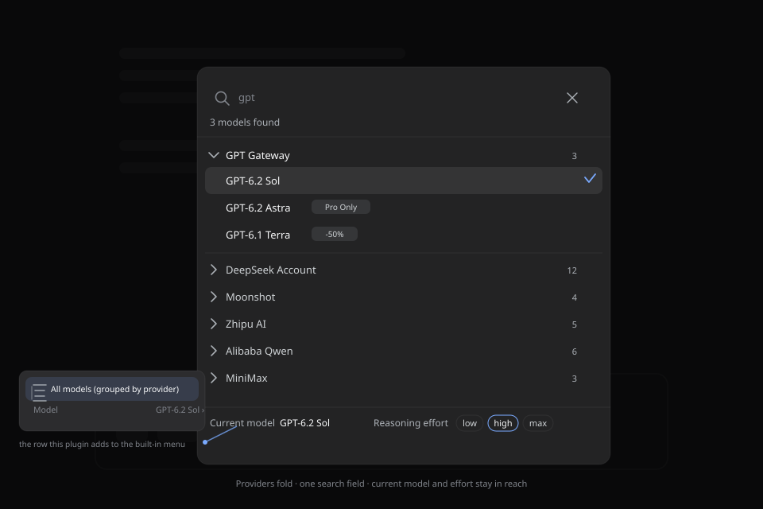

# dsh-provider-fold

English | [中文](README.md)

Makes the provider groups in DeepSeek Harness's **built-in model menu** collapsible: only the provider holding your current model starts open, everything else folds away.



## What this plugin does not do

Several "enhanced model picker" plugins already exist, and they **build a replacement panel**. This one deliberately does not, because the built-in model menu **already has**:

- models grouped by provider,
- a search field (shown past four models, with fuzzy ranking),
- reasoning-effort switching,
- whatever other plugins contribute (the Agent Teams switch, provider badges, price hints).

The **only** thing missing is that a provider heading cannot be folded, so a dozen providers and a hundred models stay laid out flat.

So this adds exactly that, inside the **existing** menu:

| | Typical "replacement picker" | This plugin |
|---|---|---|
| UI | a new panel | the built-in menu |
| Slot registrations | takes over or replaces | **none** |
| Other plugins' controls and badges | may be dropped | **all keep working** |
| After uninstalling | needs cleanup | the menu is unchanged |

Because it registers no slots and replaces no component, the Agent Teams switch, WorkBuddy's credit and promotion chips, and price hints contributed by other plugins are never lost.

---

## Install

### Option 1: command line (recommended)

```sh
dsh plugin add dsh-provider-fold
```

Reload the UI afterwards.

### Option 2: from the UI

1. Open the DSH Web UI.
2. Click **Plugins** in the left sidebar.
3. Click **Add plugin**.
4. Paste either line:

   ```
   dsh-provider-fold
   ```

   or, installing straight from GitHub (use this before an npm release):

   ```
   github:CamouflageGe/dsh-provider-fold
   ```

5. Confirm the installation, then **reload the page**.

> Installing from GitHub uses `git` and `pnpm`. If `pnpm` is not found, install it first or point
> the plugin manager's `pnpmCommand` at its path.

### After installing

Click the model button in the composer, then **Model**. The provider holding your current model is
expanded; the others are folded. Look for **Provider group fold** in Plugins.

### Uninstall

In **Plugins**, find `dsh-provider-fold` and click **Remove**, or:

```sh
dsh plugin remove dsh-provider-fold
```

The menu returns to its original behaviour immediately; this plugin stores nothing.

---

## What it solves

The built-in model menu **already groups models by provider** and **already has a search field**
(shown once a catalog holds more than four models, with fuzzy ranking). The only thing it lacks is
that a **provider heading cannot be clicked to fold its rows** — with a dozen providers and a hundred
models everything stays laid out flat.

This plugin adds exactly that, inside the existing menu:

- **only the provider holding the current model starts open**; every other provider is folded, so the
  menu opens on the model you are using instead of a hundred rows;
- every provider heading becomes a disclosure control (`role="button"` and `aria-expanded`) with an
  open/closed chevron;
- what you open or close by hand lasts for that one opening of the menu; reopening starts from the
  current provider again, and a catalog with no current model starts fully open;
- a search query expands the matching groups, and clearing it restores the folds you had;
- keyboard support: with an empty query, `↑` `↓` step through provider headings, the visible models
  and the search box; `Enter` or `Space` toggles a focused heading. Everything still folds, because
  every heading stays reachable.

## How to use it

1. Click the composer's model button to open the built-in model menu.
2. The provider holding your current model is expanded; the rest are folded.
3. Click any provider heading to expand it; click again to fold it.
4. The search field keeps working (a built-in feature) and expands every match.

Only the model menu is affected; the command popup's groups are left alone.

## How it works, and why this way

The built-in menu ships prebuilt inside `app.asar` as
`@deepseek-ai/dsh-client-ui-model-selection`. Its `MenuGroup` is an ordinary component, not a slot,
so there is **no extension point that could register a disclosure control**, and patching it
directly would mean editing DSH itself (lost on every DSH upgrade). This plugin therefore enhances
the rendered menu from the outside:

1. it injects one scoped stylesheet that only applies inside the model menu;
2. it listens for clicks and keys on provider headings;
3. it toggles the group's displayed state through an attribute.

The menu is React-rendered, so a later render can re-create rows and drop a hand-applied attribute.
A `MutationObserver` re-applies the folded state after any DOM change, so no React code is patched.

"The current provider" is located through the menu's own `aria-checked="true"` row, so it does not
depend on provider order or display names.

### Why the arrows are handled too

The shipped `moveFocus` collects **every** model row and calls `focus()` on the next one; it never
checks visibility. Folded rows are still there (`display: none`) and are still picked, but `focus()`
on them is a silent no-op — so the arrows look stuck inside the one open provider and no other
provider can be reached. That is exactly what made folding "work" while still preventing a model
switch.

So the plugin adjusts `↑` `↓` only while the search field is empty, stepping between provider
headings and visible models. With a real query the shipped ranking, `aria-activedescendant`
highlighting and `Enter`-to-choose are left untouched. One more guard: if clearing a query leaves the
shipped highlight on a row that is now folded, `Enter` or `Tab` moves focus to that provider's heading
instead of silently choosing a model nobody can see.

## Known limitations and risk

- **This is a DOM-level enhancement.** If a future DSH release renames the group markup
  (`[data-menu-group]`, `[data-menu-group-heading]`) the plugin stops working silently — it never
  breaks the menu, it simply stops folding. Those selectors are the sticky-heading contract
  `observeStickyMenuGroups` itself depends on, so they are as stable as that contract.
- Folds are tracked by the provider id the menu itself puts on each row, so reordering providers or
  renaming one cannot shift a fold onto the wrong group.
- Folded rows stay in the DOM (only `display: none`), because the shipped menu finds rows with
  `querySelectorAll` and calls `focus()`; removing them would break its own keyboard navigation.
- No configuration fields.

## What it does not touch

This plugin **registers no slots** and replaces no built-in component, so the Agent Teams switch,
provider badges, price hints and every other existing contribution keep working exactly as before.
Uninstalling restores the original menu immediately.

## Requirements

- DeepSeek Harness with the Web UI.
- `git` and `pnpm` available for installation (both the UI and the CLI path).

## Development

The client half is one plain-JavaScript bundle (`client.js`) written against the gateway's dynamic
module format: no build step and no React dependency, since it only enhances the DOM.

```js
window.__ModuleLoader__.load({ id: 'dsh-provider-fold', factory() { /* … */ } })
```

After editing, toggle the plugin off and on in **Plugins** so the browser loads the new bundle
generation.

```sh
git clone https://github.com/CamouflageGe/dsh-provider-fold.git
```

## License

[MIT](LICENSE)
