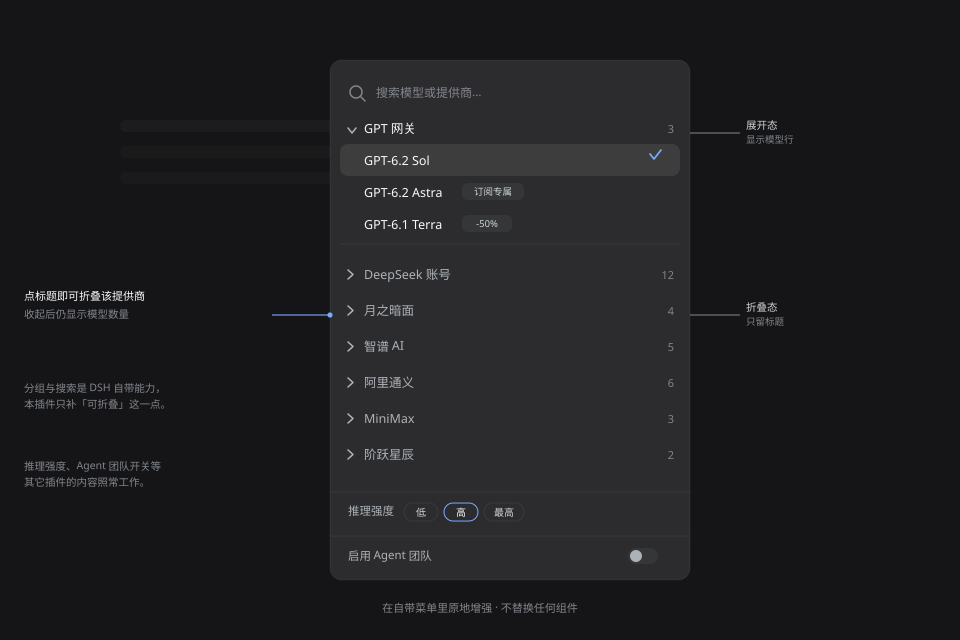

# dsh-provider-fold

中文 | [English](README.en.md)

让 DeepSeek Harness **自带的模型菜单**支持「按提供商折叠」：默认只展开你正在用的那个提供商，其余自动收起。



## 这个插件不做什么

市面上已有几个「增强模型选择器」的插件，它们会**重做一个选择面板**。这个插件刻意不走那条路，因为 DSH 自带的模型菜单**本来就已经有**：

- 按提供商分组
- 搜索框（模型超过 4 个时自动出现，支持模糊匹配）
- 推理强度切换
- 其他插件挂进去的内容（Agent 团队开关、提供商徽章、价格提示）

它**唯一缺的**就是：提供商标题点不动，十几个提供商、上百个模型永远全部铺开。

所以这里只补这一件事，加在**原来那个菜单里**：

| | 常见的「重做选择器」插件 | 本插件 |
|---|---|---|
| 界面 | 新增一个面板 | 复用自带菜单 |
| 插槽注册 | 需要接管或替换 | **零注册** |
| 其他插件的按钮/徽章 | 可能被顶掉 | **全部照常** |
| 卸载后 | 需要还原 | 菜单立即恢复原样 |

正因为不注册任何插槽、不替换任何组件，Agent 团队开关、WorkBuddy 的积分与优惠徽章、价格提示这些由别的插件挂上去的东西，一个都不会丢。

---

## 安装

### 方式一：命令行（推荐）

```sh
dsh plugin add dsh-provider-fold
```

安装后刷新界面。

### 方式二：在界面里安装

1. 打开 DSH Web 界面。
2. 点左侧边栏的 **插件**（Plugins）。
3. 点 **添加插件**（Add plugin）。
4. 在输入框里粘贴下面任意一行：

   ```
   dsh-provider-fold
   ```

   或从 GitHub 直接安装（未发布到 npm 时用这个）：

   ```
   github:CamouflageGe/dsh-provider-fold
   ```

5. 确认安装，然后 **刷新页面**。

> 从 GitHub 安装会用到 `git` 与 `pnpm`。如果提示找不到 `pnpm`，请先安装它，或在插件管理器的配置里指定 `pnpmCommand` 的路径。

### 安装完成后

点输入框上的模型按钮，再点「模型」，即可看到当前提供商展开、其余收起的列表。

插件页里它的名字是 **提供商分组折叠 / Provider group fold**。

如果插件页显示的仍是旧描述，**刷新一次页面**即可——DSH 只在插件条目启动时读取清单。

### 卸载

在 **插件** 页面找到 `dsh-provider-fold`，点 **移除**。或用命令行：

```sh
dsh plugin remove dsh-provider-fold
```

卸载后菜单立即恢复原样，本插件没有写入任何持久数据。

---

## 它解决什么

DSH 自带的模型菜单**本来就有**按提供商分组，**本来就有**搜索框（模型超过 4 个时自动出现，支持模糊匹配）。唯一缺的一点是：**提供商标题点不动**，十几个提供商、上百个模型永远全部铺开。

这个插件只补这一点，加在原来的菜单里：

- **默认只展开当前模型所在的提供商**，其余全部折叠——打开菜单第一眼就能看到你在用的模型，而不是一屏上百行
- 每个提供商标题都是可点击的折叠开关（`role="button"` + `aria-expanded`），带展开/收起箭头
- 手动展开或收起只影响本次打开的列表；关掉再打开时恢复默认。没有当前模型时默认全部展开
- 搜索时自动展开匹配分组；清空后恢复搜索前的折叠状态
- 未搜索时用 `↑` `↓` 在提供商标题、可见模型和搜索框之间移动；聚焦标题后按 `Enter` 或空格展开或收起。收起最后一个分组也不会弹回

## 使用方法

1. 点输入框的模型按钮，打开模型菜单。
2. 当前模型所在的提供商会自动展开，其余已折叠。
3. 点任意提供商标题展开它；再点一次收起。
4. 搜索框照常可用（这是自带功能），输入时会自动展开全部命中项。

默认只作用于模型菜单，命令面板（`/`）的分组不受影响。

## 实现方式（以及为什么这样实现）

自带的模型菜单打包在 `app.asar` 里的 `@deepseek-ai/dsh-client-ui-model-selection` 中，它的
`MenuGroup` 是普通组件、不是插槽，**没有可以注册折叠能力的扩展点**，直接修改又需要改动
DSH 自身（每次 DSH 升级都会丢）。所以本插件从外部增强已经渲染出来的菜单：

1. 注入一段作用域受限的样式（只在模型菜单的容器内生效）；
2. 监听提供商标题上的点击与键盘事件；
3. 通过属性切换该组的显示状态。

菜单由 React 渲染，后续重渲染会重建行节点。插件用 `MutationObserver` 在 DOM 变化后重新应用折叠状态，因此不需要修改 React 代码。

判断「当前是哪个提供商」用的是菜单里 `aria-checked="true"` 的那一行模型，不依赖提供商顺序或显示名称。

### 为什么还要接管 `↑` `↓`

内置菜单的键盘逻辑原本不考虑折叠，方向键可能走到不可见的模型。插件只在未输入搜索词时调整方向键，让焦点走过提供商标题和可见的模型；即使全部收起，也可用标题重新展开。若清空搜索后原生高亮还停在隐藏的模型上，`Enter` 或 `Tab` 会先聚焦对应标题，而不是选中看不见的模型。搜索有内容时，方向键和选择全部交给内置菜单。

## 已知限制与风险

- **这是 DOM 层面的增强**。如果未来 DSH 修改了分组标记（`[data-menu-group]`、`[data-menu-group-heading]`），插件会静默失效——不会弄坏菜单，只是不再折叠。这些选择器正是 DSH 自己的 `observeStickyMenuGroups` 所依赖的契约，因此稳定性与该契约一致。
- 折叠状态按菜单自己写在每行上的提供商 id 记录，因此重新排序或改名都不会串组。
- 收起后行仍在 DOM 里（只是 `display: none`），因为自带菜单用 `querySelectorAll` 找行并 `focus()`，删掉行会让它的键盘导航出错。
- 不提供配置项。

## 影响范围

本插件**不注册任何插槽**、不替换任何内置组件，因此：

- Agent 团队开关、提供商徽章、价格提示等一切现有贡献照常工作；
- 卸载后菜单立即恢复原始行为。

## 环境要求

- 带 Web 界面的 DeepSeek Harness。
- 安装时需要 `git` 与 `pnpm`（界面安装与命令行安装都一样）。

## 开发

客户端半边是单个纯 JavaScript bundle（`client.js`），按网关的动态模块格式编写，无构建步骤、无 React 依赖（只做 DOM 增强）。

```js
window.__ModuleLoader__.load({ id: 'dsh-provider-fold', factory() { /* … */ } })
```

修改后在**插件**页关掉再打开，浏览器才会加载新的 bundle 代。

```sh
git clone https://github.com/CamouflageGe/dsh-provider-fold.git
```

## 许可证

[MIT](LICENSE)
